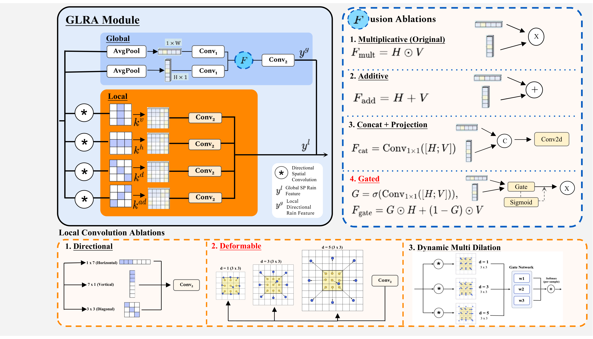
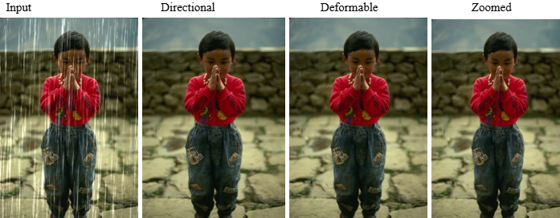
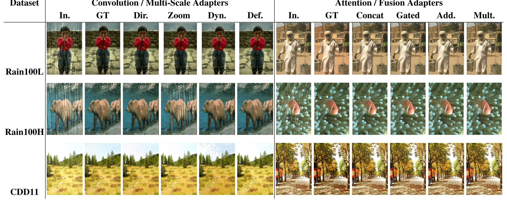

# [WACV'27 WVAQ Workshop] Frozen-Backbone Adaptation: An Empirical Study of Component Substitution in a Pretrained Deraining Network

---

## Overview

Adapting a pretrained restoration network to a new design usually means retraining the whole model. We study **Frozen-Backbone Adaptation (FBA)**: one recurring component of a pretrained deraining network is replaced, and only the new component is trained while the rest of the backbone stays frozen.

We use RAINet (2.7M parameters, 20 Image Decomposition Blocks) as the backbone and substitute the local and global pathways of its GLRA module with:

- **Convolutional adapters:** directional, deformable and dynamic multi-dilation convolutions, and the multi-scale ZoomGLRA.
- **Fusion adapters:** multiplicative, additive, concatenation and gated fusion of the global pathway.
- **Attention adapters:** channel attention, self-attention and Swin-style window attention.

With 77K to 307K trainable parameters, the directional, deformable and dynamic adapters improve on the fully trained RAINet on Rain100L. We also compare adapting GLRA with adapting the DCMLP module, and test zero-shot transfer and target-domain adaptation on Rain100H and CDD11.

## Architecture

[](assets/glra.png)

## Results

Rain100L, PSNR and SSIM on the Y channel.

| Method | Trainable params | PSNR ↑ | SSIM ↑ | LPIPS ↓ |
|---|---|---|---|---|
| RAINet (fully trained) | 2.7M | 37.850 | 0.9796 | 0.01627 |
| ZoomGLRA | 96K | 36.648 | 0.9773 | 0.01072 |
| Directional | 77K | 38.987 | 0.9828 | 0.01252 |
| Dynamic | 307K | 39.043 | **0.9831** | **0.01210** |
| Deformable | 219K | **39.052** | **0.9831** | 0.01261 |

## Examples

[](assets/example.png)

[](assets/comparison.png)

Rainy input, ground truth and adapter outputs on Rain100L, Rain100H and CDD11, for the convolutional and multi-scale adapters (left) and the fusion adapters (right).

## Installation

```bash
git clone https://github.com/ToyioUdoete/Frozen-Backbone-Adaptation.git
cd Frozen-Backbone-Adaptation
conda create -n fba python=3.10 -y && conda activate fba
pip install torch==2.2.2 torchvision==0.17.2 --index-url https://download.pytorch.org/whl/cu121
pip install -r requirements.txt
```

## Data

Download Rain100L, Rain100H and CDD11 from their official sources and set the dataset paths in the scripts (`--data_path` and `--gt_path`, or the paths at the top of each script).

## Checkpoints

`checkpoints/` holds the adapter weights used in the paper, for Rain100L, Rain100H and CDD11:

| Folder | Files |
|---|---|
| `*_GLRA/` | `directional.pt`, `deformable.pt`, `dynamic.pt` |
| `*_Zoom/` | ZoomGLRA (`zoom.pt`, `zoom_glra.pt` for Rain100L) |

## Repository structure

```
models/
  rainet/      RAINet backbone (Network, BottleCSP, GLRA, DCMLP), data loading, original training and testing
  adapters/    GLRA adapters, ZoomGLRA, strip fusion and DCMLP adapters, evaluation metrics
scripts/
  train_main.py                       end-to-end training
  train_frozen_glra_ablation.py       frozen GLRA convolutional adapters
  train_frozen_embedding_ablation.py  frozen DCMLP adapters
  train_frozen_zoom_ablation.py       ZoomGLRA
  train_variant.py                    attention and fusion adapters (--variant gated, concat, swin_attn, ...)
  test_glra_rain100h_all.py, test_glra_cdd11_all.py   GLRA adapters on Rain100H and CDD11
  test_zoom_rain100h.py, test_zoom_cdd11.py           ZoomGLRA on Rain100H and CDD11
  test_all_variants.py                attention and fusion adapters
  eval_lpips.py                       LPIPS (AlexNet)
  summarize_results.py                result tables
checkpoints/   adapter weights
```

Under FBA only the substituted adapter is trained; the rest of the pretrained RAINet stays frozen. Each adapter is trained on an 80/20 train-validation split (seed 66), and the checkpoint with the best validation PSNR is used for testing.

## License

The code is released under the [MIT License](LICENSE). The datasets keep the licenses of their sources.

## Acknowledgements

We build on RAINet as the pretrained backbone, and on the Rain100L, Rain100H and CDD11 datasets.
